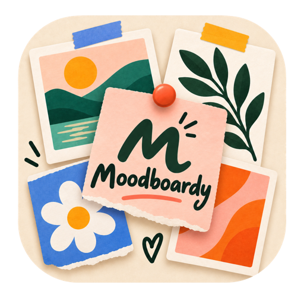

  

<h1 align="center">Moodboardy</h1>

  <strong>A little space for big ideas.</strong> 
  A whole canvas of possibilities. 
  Collect images, stray thoughts and things worth keeping — and make them yours.

  
  
  
  
  

<!-- Replace YOUR-USERNAME (and the repository name if needed) with your GitHub Pages address. -->

  

No sign-up. No noise. Just your ideas.

---

## ✨ Your ideas, all in one happy place

Build a moodboard for your next room makeover, brand identity, dream trip or very specific new obsession. Think cream paper, peach sticky notes, forest-green ink and little pops of coral, butter yellow and blue.

No feed to scroll. No account to create. Just an open space to play.

## 📌 The good stuff

| Feature | Make it yours |
| --- | --- |
| 🖼️ **Collect your inspiration** | Upload, drop or paste images onto your canvas. Add captions and keep your references together. |
| 📝 **Catch every thought** | Add colorful sticky notes and free text, from tiny reminders to big ideas. |
| 🌼 **Add a little personality** | Sprinkle in emoji and shapes. Give your board its own mood. |
| 🔗 **Keep your links close** | Paste URLs as simple link cards, ready to revisit. |
| ↗️ **Connect the dots** | Use lines and attached arrows to show how your ideas fit together. |
| 🪄 **Arrange it your way** | Move, resize, multi-select and group items. Undo and redo while you experiment. |
| 🌍 **Room to wander** | Explore an infinite canvas with pan and zoom. No page edges, no fixed layout. |
| 🗂️ **One tab per obsession** | Create multiple canvases, rename them and drag their tabs into your favorite order. Each remembers its own view. |
| 💾 **Pick up where you left off** | Your canvases save automatically in the same browser, on the same site. |
| 🎒 **Take your boards with you** | Export a canvas as JSON and import it elsewhere, without replacing your other canvases. |

## 🌱 From blank canvas to new favorite thing

1. **Drop something you love.** An image, a link, a few words. Start anywhere.
2. **Build the vibe.** Add notes, colors, emoji and connections. Move things until it feels right.
3. **Make room for more.** Open another canvas for your next idea. Export your favorites as backups.

**Little shortcuts, big flow:** paste with **⌘/Ctrl + V**, drag the background to explore, and use **Ctrl + scroll** to zoom. Press **?** for the full shortcut guide.

### A few handy canvas tricks

- Click **+** to start a new canvas, and click a tab to switch.
- Double-click a tab name, or use **✎**, to rename it.
- Drag tabs to reorder them. Press **Escape** to cancel, or use **Alt + ← / →** with a tab name focused.
- Open **⋯ → Export JSON** to download the current canvas, including uploaded images and its saved view.
- Choose **⋯ → Import JSON**, or drop a JSON file onto the page, to open it in a new tab. Older Moodboard exports work too.
- Use **×** to remove a canvas after confirmation. Closing the last one gives you a fresh start.

## 🏡 Your browser is home

Your boards are stored in your browser's `localStorage`, not in an app database. There are no accounts, cloud sync, sharing links or server-side backups.

- **Back up the boards you love.** Clearing site data or using private browsing can remove them. Export JSON regularly.
- **New browser, new space.** Boards do not automatically follow you to another browser, device or website address. Use export and import to move them.
- **Keep images light.** Browser storage is limited, usually to a few MB. If a save warning appears, export your work and reduce large images. Avoid editing the same site in multiple windows at once.
- **Local uploads travel better.** Images added by URL stay remote and may disappear. Upload files to include the images in your JSON backup.
- **An internet connection is needed.** Fonts, Tailwind CSS and Alpine.js load from external CDNs; remote images also contact their hosts. Link cards do not fetch metadata or previews.
